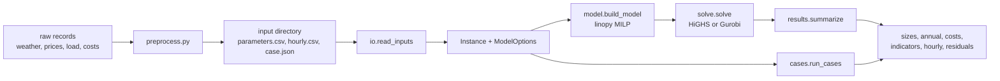

# Architecture

## Modules

| Module | Content |
|---|---|
| `parameters.py` | `PARAMETERS` (symbol, unit, description, lower bound, default of every parameter), `Parameters` (validated values), `canonical_units`, present-worth factor `pwf`, `FinancialFactors` ($f^{om}$, $f^{e}$, $f^{tow}$, $f^{pi}$), `effective_capital_cost` |
| `inputs.py` | `Configuration` (candidate technologies), `Instance` (configuration, parameters, hourly series, fixed sizes; validated by `Instance.create`), `SERIES` and their units |
| `model.py` | `ModelOptions`, `build_model` (the linopy model; constraint names carry the equation numbers), `PlanningModel` |
| `solve.py` | `solve`: in-memory hand-over to HiGHS (default) or Gurobi; raises `SolveError` unless the solution is optimal |
| `results.py` | `summarize` (sizes, annual quantities, cost terms, indicators, hourly dispatch), `balance_residuals` |
| `cases.py` | `CONFIGURATIONS`, `Case`, `configuration_cases`, `hydrogen_price_cases`, `run_cases` |
| `preprocess.py` | interval-to-hour aggregation, leap-day removal, production factors, availability, price units |
| `io.py` | `read_inputs`, `write_inputs` (input directory format of `docs/data_pipeline.md`) |
| `synthetic.py` | invented example data and illustrative parameters |
| `cli.py` | `reopt-h2-framework synthetic DIR` and `reopt-h2-framework run DIR --out-dir OUT` |

## Data flow

## Solvers

- **HiGHS** (open source, `highspy`) is the default, with a relative MIP gap of 1e-6.
- **Gurobi** is optional: `solve(pm, solver="gurobi")`. It needs `gurobipy` and a licence.
- Other solvers supported by linopy can be named in `solve(pm, solver=...)`. Solver options are passed unchanged, e.g. `options={"time_limit": 600}`.

## Problem size

For one year (8,760 hours), the configuration with wind, battery, electrolyzer, tank and fuel cell has about 193,000 variables and 184,000 constraints:

- With `on_off="binary"` (Eq. 34 as stated), 26,280 of the variables are binary.
- With `on_off="fixed_on"`, there are 166,000 variables and none is binary unless production incentives or fixed capital costs are used.

On the synthetic data, both forms of the full year solve to optimality in seconds with HiGHS and with Gurobi, and give the same objective. The binaries of Eq. (2) are inactive at the optimum. Real data, incentives and fixed capital costs can make the problem harder.

## Output tables

`Summary.to_csv(directory)` and the command line write:

| File | Content |
|---|---|
| `sizes.csv` | size of every component (kW, kWh, kg/h, kg, kW_th, kWh_th) |
| `annual.csv` | generation, available and unused wind and PV energy, explicit curtailment, delivery, battery discharge, electrolyzer electricity, grid purchases (including CSP parasitics), hydrogen produced, sold and used in the fuel cell, CSP heat (per year) |
| `costs.csv` | capital, O&M, revenue, incentives and purchases as they enter Eq. (1) (present value, \$), the objective, and their sum as a check |
| `indicators.csv` | unused share of available wind and PV energy, electrolyzer capacity factor, LCOH, LCOE of wind and PV |
| `hourly.csv` | hourly dispatch of every flow and storage level |
| `balance_residuals.json` | largest residual of Eqs. (6), (13), (15), (17), (20)–(22) and the site load balance, recomputed from the solution |

## Tests

`pytest` runs tests of:

- **Parameters and inputs:** present-worth factors against the explicit sum, parameter, series and configuration validation, and the input-directory round trip with unit and format checks.
- **Preprocessing helpers.**
- **Model:**
  - each configuration solves with balance residuals below 1e-6 and delivery equal to the target;
  - the cost terms add up to the objective;
  - the binary and fixed-on forms of Eq. (2) give the same optimum;
  - storage, hydrogen and capacity bounds;
  - site load with outage hours;
  - interconnection limit;
  - constant-rate electrolysis;
  - CSP heat supply and thermal storage balance;
  - production incentive eligibility (Eqs. 10–11);
  - build indicator;
  - shortfall extension;
  - the LCOH definition recomputed by hand;
  - case runs and sweeps;
  - Gurobi against HiGHS (skipped without a Gurobi licence).
- **Command line.**
